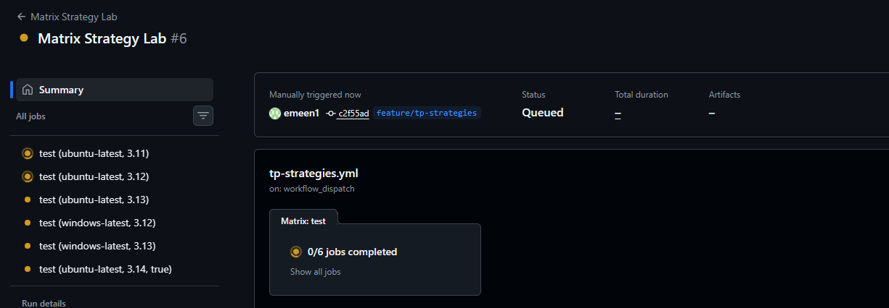

# TP 8 – Stratégies GitHub Actions

## Q1. Combien de jobs sont générés ?

**6 jobs** (2 OS × 3 versions de Python) :

- ubuntu-latest / 3.11
- ubuntu-latest / 3.12
- ubuntu-latest / 3.13
- windows-latest / 3.11
- windows-latest / 3.12
- windows-latest / 3.13

## Q2. Combien de jobs au total ?

**6 jobs.**

- Matrice de base : 6
- `exclude` enlève windows / 3.11 → 5
- `include` ajoute ubuntu / 3.14 (expérimental) → **6**

## Q3. Que se passe-t-il si on exclut la combinaison 3.14 ?

**Rien : le job 3.14 est quand même créé.**

`exclude` est appliqué **avant** `include`. Au moment de l'`exclude` la combinaison
ubuntu / 3.14 n'existe pas encore, donc il n'y a rien à exclure. Elle est ajoutée
ensuite par `include`. Pour l'enlever il faut la supprimer du bloc `include`.

## Q4. fail-fast : true vs false

- **`fail-fast: true`** : windows / 3.12 a échoué en premier, et GitHub a **annulé**
  windows / 3.13. Résultat : 4 réussis, 1 échoué, 1 annulé.
- **`fail-fast: false`** : **aucun job annulé**, tous vont jusqu'au bout.
  Résultat : 4 réussis (Ubuntu), 2 échoués (Windows).

**Quand choisir ?**

- **`true`** : pour les pull requests et le CI quotidien. Un seul échec suffit à
  refuser le changement donc on arrête vite et on économise des minutes.
- **`false`** : pour savoir exactement quelles combinaisons OS / version échouent , pour diagnostic de compatibilité avant une release.

## Q5. Deux raisons d'utiliser max-parallel en entreprise

1. **Limiter les coûts et l'usage des runners** : les minutes sont payantes et le nombre
   de runners est limité. Un seul workflow ne doit pas bloquer les autres équipes.
2. **Ne pas surcharger les ressources partagées** : base de données de test, serveur de
   staging ou API externe avec une limite de requêtes.

