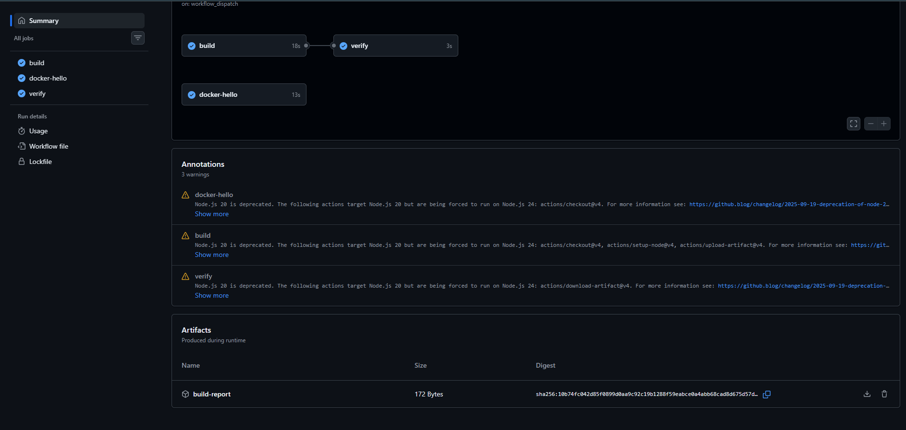

# TP7 – Actions tierces et actions personnalisées

**Q1.** checkout marche avec ses valeurs par défaut. Il récupère le dépôt et le commit en cours. setup-node doit savoir quelle version de Node.js installer.

**Q2.** Chaque job tourne sur une machine différente. Le fichier créé dans build n'existe pas dans verify. L'artefact garde le fichier sur GitHub pour que verify le télécharge.

**Q6.** Une action locale est un fichier du dépôt. Sans checkout le dépôt n'est pas sur le runner et GitHub ne trouve pas action.yml.

**Q7.** Une action composite n'a pas de shell par défaut. Il faut l'indiquer sur chaque step run.

**Partie 4.** L'action Docker prend 9 s car l'image est construite puis lancée dans un conteneur à chaque run. L'action composite prend 0 s car elle exécute directement des commandes sur le runner.

## Capture
