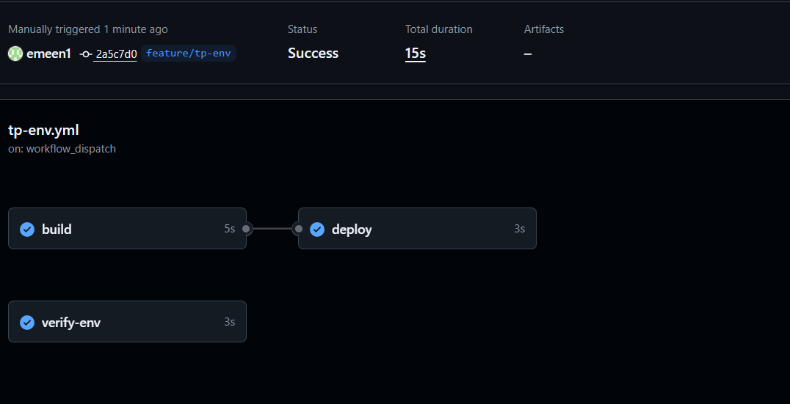

# TP6 – Variables d'environnement, Inputs et Outputs

**Q1.** Le runner lit le fichier GITHUB_ENV à la fin de la step. Les variables sont donc disponibles seulement dans les steps suivantes.

**Q2.** La variable est vide dans verify-env. Chaque job tourne sur sa propre machine. GITHUB_ENV est limité au job qui l'a défini.

**Q3.** `>` écrase le fichier. Seul le dernier output est gardé et le premier est perdu.

**Q4.** GITHUB_ENV ne sort pas du job. GITHUB_OUTPUT déclaré dans `outputs:` est transmis aux jobs qui utilisent `needs`.

**Q5.** Le job deploy démarre en même temps que build. Il ne reçoit pas l'output et la version affichée est vide.

## Capture
